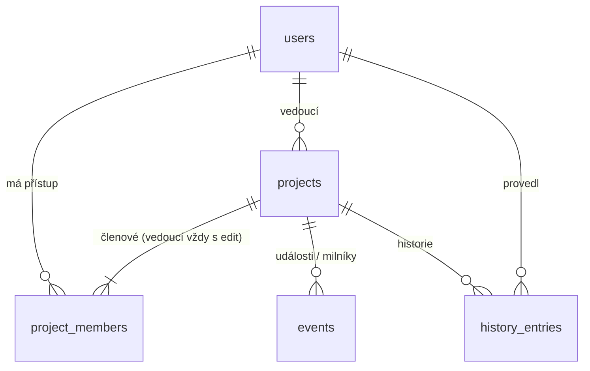

# Databáze V2-1 – návrh první migrace ke schválení

> **Stav: SCHVÁLENO a APLIKOVÁNO (17. 11. 2026) na prázdnou vývojovou databázi V2** (`data/dev/db`, mimo Git)
> s fiktivními daty. Před prvním použitím byla migrace upravena podle upřesnění vlastníka (kap. 2a).
> Od této chvíle se migrace 0000 a 0001 nemění; další změny schématu = nové migrace se schválením.

## 1. Soubory

| Soubor | Obsah |
|---|---|
| `src/server/db/schema.ts` | schéma v TypeScriptu (zdroj pravdy pro migraci) |
| `src/domain/values.ts` | povolené hodnoty a české popisy – sdílí je doména i databázová omezení |
| `drizzle/0000_v2_1_zaklad.sql` | vygenerovaná migrace: 5 tabulek, omezení, cizí klíče, indexy |
| `drizzle/0001_v2_1_ochrany.sql` | ruční část: ochrana historie, vedoucí = člen s úpravami |
| `drizzle/meta/*` | evidence migrací pro drizzle-kit |

## 2. Tabulky a vazby

| Tabulka | Účel | Klíčová omezení v databázi |
|---|---|---|
| `users` (11 sloupců) | fiktivní uživatelé; role `admin` / `deputy` / `viewer` (správce / zástupce / sledující) | e-mail jedinečný a malými písmeny; výchozí role = sledující (nejmenší oprávnění); příznak `is_dev_identity` |
| `projects` (15) | zakázky | **žádný sloupec s termínem**; typ „jiná“ vyžaduje upřesnění; archivace jen s kdo/kdy/proč |
| `project_members` (5) | přístup k zakázce `edit` / `read` | jedno členství na dvojici zakázka–uživatel |
| `events` (20) | události a milníky | vlastní id; `contract_date`, `planned_date`, `actual_date` **nepovinné**; skutečné datum jen s kdo/kdy zapsal; zrušení jen s důvodem; **více událostí stejného typu povoleno** |
| `history_entries` (9) | historie změn | jen přidávání – úpravu, smazání i vyprázdnění odmítne trigger |

Společné: `version` u upravitelných tabulek (ochrana souběžných úprav, Q8), autor a čas vytvoření/změny,
všechny cizí klíče `ON DELETE RESTRICT` (nic nezmizí „kaskádou“; mazání jen podle pravidel Q9).

### 2a. Upřesnění při schválení (zapracováno před prvním použitím)
- **Vedoucím zakázky nesmí být sledující.** Databáze to hlídá při založení zakázky, při změně vedoucího
  i při změně globální role uživatele, který nějakou zakázku vede (`drizzle/0001_v2_1_ochrany.sql`).
  Založení zakázky a zápis vedoucího mezi členy s úpravami proběhne v jedné transakci.
- **Pravidlo jednoho zdroje termínů hlídá jen kopie termínů událostí a milníků** (`src/server/db/schemaRules.ts`).
  Samostatné termíny objednávek, dodávek materiálu, úkolů nebo datum dokumentu jsou povolené – ověřeno testy
  i na ukázkové budoucí tabulce materiálu.

### Změna oproti plánu (podle vašeho rozhodnutí)
- **Zrušeno** pravidlo „každý typ události jen jednou“. Typ je jen výchozí nabídka; název je vlastní
  (např. „Zahájení montáže technologie – linka 2“). Ověřeno testem.
- Budoucí materiál a připravenost budou odkazovat na **`events.id`** (konkrétní událost), nikdy na typ.
- Globální role: místo „správce / uživatel“ jsou tři – **správce / zástupce / sledující**. Důvod: zástupce smí
  zakládat zakázky, sledující ne; dvě role by to nerozlišily.

## 3. Jak funguje přístup uživatelů

Skutečný přístup = **globální role** × **členství v zakázce**. Rozhoduje funkce
`src/domain/access/permissions.ts` (bude ji volat každá serverová služba – ne skrytí tlačítka).

| | Správce | Zástupce | Sledující |
|---|---|---|---|
| Vidí zakázky | všechny | jen přidělené | jen přidělené |
| Čte události, členy a historii | ✅ | ✅ přidělené | ✅ přidělené (Q7) |
| Zakládá zakázky | ✅ | ✅ (stane se členem s úpravami) | ❌ |
| Upravuje zakázku a události | ✅ | ✅ přidělené s přístupem `edit` | ❌ nikdy – ani s omylem nastaveným `edit` |
| Přiděluje přístupy | ✅ | ❌ | ❌ |
| Archivuje / obnovuje zakázku | ✅ (s důvodem) | ❌ | ❌ |

- Nepřidělená zakázka se chová, jako by neexistovala („Zakázka nebyla nalezena“).
- Archivovaná zakázka je jen pro čtení – i pro správce, dokud ji neobnoví (zapíše se do historie).
- Deaktivovaný účet nesmí nic.
- **Vedoucí zakázky je vždy jejím členem s úpravami** – hlídá to přímo databáze (kontrola na konci transakce).
- Vývojová identita (výběr fiktivního uživatele) vznikne až v dalším kroku podle schváleného plánu;
  v databázi je pro ni připraven jen příznak `is_dev_identity`.

## 4. Dopad migrace

- **Na existující data: žádný.** V2 zatím nemá žádnou databázi; migrace vytvoří nová prázdná schémata.
- **Na V1: žádný.** Jiný repozitář, jiná databáze.
- **Vratnost:** vývojová databáze bude ve složce `data/` (mimo Git) – při chybě ji lze smazat a vytvořit znovu.
  Po schválení se tato migrace už nebude přepisovat; další změny = nové migrace.
- **Jak se aplikuje:** `npm run db:setup` (jen na prázdnou databázi; existující nepřepíše), v Codespaces automaticky
  při vytvoření prostředí. Testy používají dočasnou databázi v paměti, testy v prohlížeči samostatnou `data/e2e`.

## 5. Ověření (automatické testy)

| Oblast | Testy |
|---|---|
| Migrace | proběhne na prázdné databázi a vytvoří přesně 5 tabulek; `drizzle-kit check` bez chyb; schéma a migrace se neliší |
| Jeden zdroj termínů | sloupce typu `date` jen `events.contract_date/planned_date/actual_date`; zakázka nemá žádný termín; časová razítka jen jako metadata (`*_at`) |
| Události | 2× „Zahájení montáže“ v jedné zakázce s různými termíny; všechny termíny prázdné; skutečné datum bez autora odmítnuto; zrušení bez důvodu odmítnuto |
| Zakázky | typ „jiná“ bez upřesnění odmítnut; archivace bez důvodu odmítnuta; zakázku s událostmi nelze smazat |
| Vedoucí | zakázka bez členství vedoucího odmítnuta; vedoucímu nelze odebrat členství ani snížit přístup; změna vedoucího jen s jeho členstvím |
| Historie | přidání ano; úprava, smazání a vyprázdnění odmítnuto |
| Uživatelé | e-mail jedinečný a malými písmeny; neznámá role odmítnuta; výchozí role sledující |
| Oprávnění (doména) | celá matice správce / zástupce / sledující / deaktivovaný × akce |
| Termíny (doména) | původ data vždy uveden; plán nikdy jako „nastalo“; skutečné datum ne v budoucnu; změna smluvního a oprava skutečného data jen s důvodem |
| Kalendář (z V1) | české svátky, pracovní dny, Europe/Prague; nově kontrola platného data |
| Architektura | doména bez Reactu, Next.js, Node a databáze; obrazovky bez přímého přístupu k databázi (lint + test) |

## 6. Kontrola závislostí

| Balíček | Verze | Licence | Poznámka |
|---|---|---|---|
| `drizzle-orm` | 0.45.4 | Apache-2.0 | stejná verze jako V1; podporuje PGlite |
| `@electric-sql/pglite` | 0.5.16 | Apache-2.0 | stejná verze jako V1 |
| `drizzle-kit` | 0.31.11 | MIT | jen vývojový nástroj |
| `@playwright/test` | 1.65.1 | Apache-2.0 | jen vývojový nástroj (testy v prohlížeči) |

- Verze jsou **pevně zafixované** (bez `^`), aby se nic nezměnilo bez vědomí.
- `npm audit --omit=dev` (vše, co poběží v aplikaci): **0 zranitelností**.
- `npm audit` včetně vývojových nástrojů: 4 nálezy „moderate“, všechny ve **starém `esbuild` uvnitř `drizzle-kit`**.
  Chyba se týká vývojového webového serveru esbuild, který drizzle-kit nespouští; do aplikace se nedostane.
  Přijato jako známé riziko; sledovat novou verzi drizzle-kit.
- Licence všech balíčků jsou volné (MIT, Apache-2.0, ISC, BSD…); LGPL je jen knihovna obrázků `sharp-libvips`,
  kterou přináší už samotný Next.js (dynamicky linkovaná, v pořádku i pro firemní použití).
