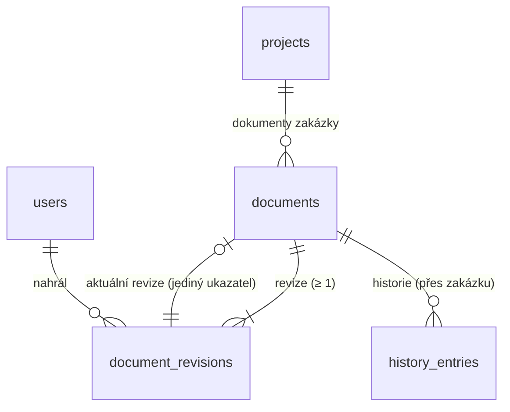

# Databáze V2-2 – návrh migrace 0002 (Dokumenty) ke schválení

> **Stav: SCHVÁLENO a APLIKOVÁNO (17. 11. 2026)** na vývojovou databázi V2 s fiktivními daty.
> Migrace `0002_v2_2_dokumenty` je v `drizzle/schvalene-migrace.json`. Schválené migrace se už nemění.

## 1. Soubory

| Soubor | Obsah |
|---|---|
| `src/server/db/schema.ts` | nové tabulky `documents`, `document_revisions` |
| `src/domain/values.ts` | druhy dokumentů, povolené druhy souborů, rozšíření hodnot historie |
| `drizzle/0002_v2_2_dokumenty.sql` | vygenerovaná část (tabulky, omezení, indexy) + ruční část (ochrany) |
| `drizzle/schvalene-migrace.json` | seznam schválených migrací (pojistka) |
| `src/server/db/migration0002.test.ts` | testy migrace a ochran |

## 2. Tabulky a vazby

### `documents` – dokument jako logická věc
| Sloupec | Poznámka |
|---|---|
| `id`, `project_id` → projects | dokument nelze přesunout do jiné zakázky (trigger) |
| `category` | `contract` Smlouvy a dodatky · `budget` Rozpočty · `design` Projektová dokumentace a výkresy · `site_meeting` Zápisy z KD · `diary_export` Export stavebního deníku · `protocol` Protokoly a revize · `photo` Fotografie · `other` Ostatní |
| `title`, `note` | název povinný. **Dodatek smlouvy = samostatný dokument** (schváleno) |
| `current_revision_id` | **jediný ukazatel aktuální revize**; složený cizí klíč zaručí, že patří témuž dokumentu |
| `status`, `archived_at/by`, `archive_reason` | archivace jen s důvodem |
| `version`, `created_*`, `updated_*` | ochrana před souběžnou úpravou (Q8) |

### `document_revisions` – konkrétní nahraný soubor (neměnný)
| Sloupec | Poznámka |
|---|---|
| `id`, `document_id` → documents | |
| `revision_no` | 1, 2, 3… jedinečné v rámci dokumentu |
| `revision_label` | nepovinné vlastní označení („C“, „Rev. 2“) |
| `document_date` | datum dokumentu – samostatný údaj, ne kopie termínu události (pravidlo z V2-1 ho povoluje) |
| `original_filename` | jen pro zobrazení / stažení; bez `/`, `\` a řídicích znaků, max. 255 znaků |
| `file_kind` | druh zjištěný **z obsahu** souboru (kap. 4) |
| `size_bytes`, `sha256` | velikost a otisk pro kontrolu celistvosti |
| `storage_key` | klíč v úložišti generovaný serverem, **jedinečný** → nelze přepsat existující soubor |
| `note`, `uploaded_at`, `uploaded_by` | |

### Rozšíření `history_entries`
Povolené hodnoty se rozšíří o druhy `document`, `document_revision` a akce `upload_revision`,
`set_current_revision`. Stávající záznamy se nemění (výměna omezení CHECK).

## 3. Co hlídá přímo databáze

| Požadavek | Jak |
|---|---|
| Dokument má vždy jednoznačně určenou aktuální revizi | trigger na konci transakce + jediný ukazatel |
| Aktuální revize patří témuž dokumentu | složený cizí klíč `(id, current_revision_id)` → `(document_id, id)` |
| Stará revize vždy zůstane dostupná | revize nelze upravit, smazat ani vyprázdnit (trigger); dokument ani zakázku s dokumenty nelze smazat |
| Nahrávání nepřepíše existující soubor | jedinečný `storage_key`; navíc úložiště zapisuje jen do nového souboru (kap. 5) |
| Bezpečný klíč souboru | jen `a-z 0-9 / _ -`, žádné `..`, nezačíná `/` |
| Platné údaje | druh souboru ze seznamu (ZIP odmítnut), velikost > 0, otisk SHA-256 ve správném tvaru |

## 4. Kontrola typu souboru (navržená pro implementaci V2-2)

Rozhoduje **obsah souboru**, ne přípona ani údaj prohlížeče. Přípona musí odpovídat zjištěnému druhu.

| Druh | Kontrola obsahu |
|---|---|
| PDF | začíná `%PDF-` |
| JPG | začíná `FF D8 FF` |
| PNG | přesná 8bajtová hlavička PNG |
| WEBP | `RIFF` … `WEBP` |
| HEIC (fotky z iPhonu) | blok `ftyp` se značkou `heic` / `heix` / `mif1` |
| TIFF (skeny) | `II*\0` nebo `MM\0*` |
| XLSX, DOCX | kontejner Office: přečte se jen obsah (seznam souborů uvnitř), nic se nerozbaluje na disk. Musí obsahovat `[Content_Types].xml` a `xl/` resp. `word/`. **Odmítnou se soubory s makry** (`vbaProject.bin`), šifrované a nesmyslně velké po rozbalení |
| DWG | začíná `AC10` + číslo verze (např. `AC1032`); jen uložit a stáhnout |
| DXF | binární DXF: hlavička `AutoCAD Binary DXF`; textové DXF: čitelný text bez nulových bajtů, začíná skupinou `0` / `SECTION` (nebo komentářem `999`); jen uložit a stáhnout |

Vždy odmítnuto: ZIP a jiné archivy, HTML, SVG, skripty, spustitelné soubory, prázdný soubor.
**Otevřít v prohlížeči** jde jen PDF, JPG, PNG a WEBP (v izolovaném režimu `sandbox`, s `nosniff`);
ostatní (včetně HEIC, TIFF, DWG, DXF, XLSX, DOCX) se jen stahují. Nic se automaticky nevykresluje ani neinterpretuje.

## 5. Nahrávání souborů do 50 MB – zvolený postup

**Zjištění (ověřeno přímo v kódu Next.js 16.4.6):**
- Serverové akce (dosavadní formuláře) načítají **celý požadavek do paměti** (v kódu Next.js označeno
  „TODO: Add streaming support“) a limit `serverActions.bodySizeLimit` (výchozí 1 MB) platí **pro všechny
  formuláře aplikace najednou**. Prosté zvýšení na 50 MB by zvětšilo prostor pro zahlcení u každého formuláře.
- Samostatná serverová adresa (route handler) dovolí číst soubor **po částech**; limit 10 MB pro proxy
  (`proxyClientMaxBodySize`) se uplatní jen s middlewarem, který V2 nemá.

**Návrh:** samostatná adresa jen pro nahrání souboru `POST /zakazky/<id>/dokumenty/nahrat`:
1. Soubor se posílá jako tělo požadavku (údaje formuláře v hlavičkách), server ho **průběžně zapisuje do
   dočasného souboru**, počítá velikost a otisk SHA-256 a **přeruší nahrávání ihned po překročení limitu**
   (`MAX_UPLOAD_MB`, výchozí 50) – paměť se nezaplní, ostatní formuláře zůstávají na limitu 1 MB.
2. Ověření typu podle obsahu (kap. 4) → přesun na konečný klíč **jen pokud soubor ještě neexistuje**
   (zápis s příznakem „vytvořit nový“ – nikdy nepřepsat) → transakce v databázi (revize + ukazatel + historie).
   Při chybě se soubor smaže.
3. **Ochrana proti CSRF** (serverové akce ji mají vestavěnou, adresa ji potřebuje doplnit):
   kontrola `Origin` proti `Host` / `x-forwarded-host` se stejným seznamem výjimek jako u formulářů
   (jen `localhost:3000` a adresa tohoto Codespaces při `npm run dev`), povinná vlastní hlavička
   (prohlížeč ji z cizí stránky bez souhlasu serveru neodešle) a cookie `SameSite=Lax`.
4. Oprávnění a identita se ověří **před přijetím dat** i znovu v transakci (podle konkrétní zakázky).

**Ověření při implementaci:** malý soubor, soubor těsně pod limitem (~49 MB), soubor přes limit (odmítnut
bez zaplnění disku a paměti), přes localhost i přes simulaci Codespaces (proxy z opravy `dfc4f46`).
Skutečný limit přesměrování portů GitHub Codespaces neznám z dokumentace – ověříte ho jedním nahráním
~45 MB fiktivního souboru ve vašem Codespaces; aplikace případné odmítnutí srozumitelně ohlásí.

## 6. Pojistka schvalování migrací (nové)

Soubor `drizzle/schvalene-migrace.json` obsahuje schválené migrace. `npm run db:setup` i `db:migrate`
odmítnou pracovat, dokud je ve složce `drizzle/` migrace mimo seznam – **databáze se nezmění**
(chrání i nový Codespace vytvořený z této větve). Výjimka jen pro dočasnou testovací databázi
testů v prohlížeči (`data/e2e`). Po vašem schválení přidám `0002_v2_2_dokumenty` do seznamu.

## 7. Dopad migrace 0002

- Pouze **přidává** dvě tabulky a rozšiřuje povolené hodnoty historie. Zakázky, události, členové,
  oprávnění a historie z V2-1 se nemění – **ověřeno testem** (otisk všech dat V2-1 před a po migraci je shodný).
- Ve vašem Codespaces po schválení: zastavit aplikaci → `git pull` → `npm run db:migrate` → `npm run dev`.
- Žádná nová knihovna.

## 8. Výsledek kontrol při návrhu (před schválením)

- `npm run check` (typy, lint, testy, build): ✅ – 143 testů (12 souborů), z toho 12 nových pro migraci 0002.
- `npm run test:e2e`: ✅ 10 testů (funkce V2-1 beze změny).
- `drizzle-kit check`: ✅; schéma a migrace jsou ve shodě.
- Vývojová databáze: beze změny (5 tabulek), migrace odmítnuta pojistkou.

## 9. Implementace V2-2 – doplňující poznámky

- **Oživení stránky ve vývojovém režimu:** Next.js 16 (Turbopack) oživí stránku až po spojení WebSocket
  `/_next/hmr`. Formulář pro nahrávání proto povolí tlačítko až po oživení; jinak ukáže „Načítám formulář…
  obnovte stránku“ – nic se neodešle naslepo (ověřeno testem). V Codespaces Next.js spojení z adresy
  Codespace přijímá (`allowedDevOrigins`).
- **„Otevřít“ PDF:** obrázky se posílají s `Content-Security-Policy: sandbox`; u PDF se `sandbox` nepoužívá,
  protože vestavěný prohlížeč PDF by se v izolovaném režimu nezobrazil. Bezpečnost u PDF zajišťuje ověřený
  obsah (`%PDF-`), pevně daný typ `application/pdf` a `nosniff`.
- **Přetržené nahrání bez ohlášené velikosti:** server přestane číst hned po překročení limitu; klient,
  který dál zapisuje, může dostat ukončené spojení místo odpovědi 413. Prohlížeč velikost vždy ohlásí,
  takže uživatel dostane srozumitelnou odpověď hned.
- **Úklid:** dočasné soubory (`.tmp/`) se mažou při chybě i přerušení; zbytky po případném pádu serveru se
  uklidí automaticky při dalším nahrávání (starší než 1 hodina).
