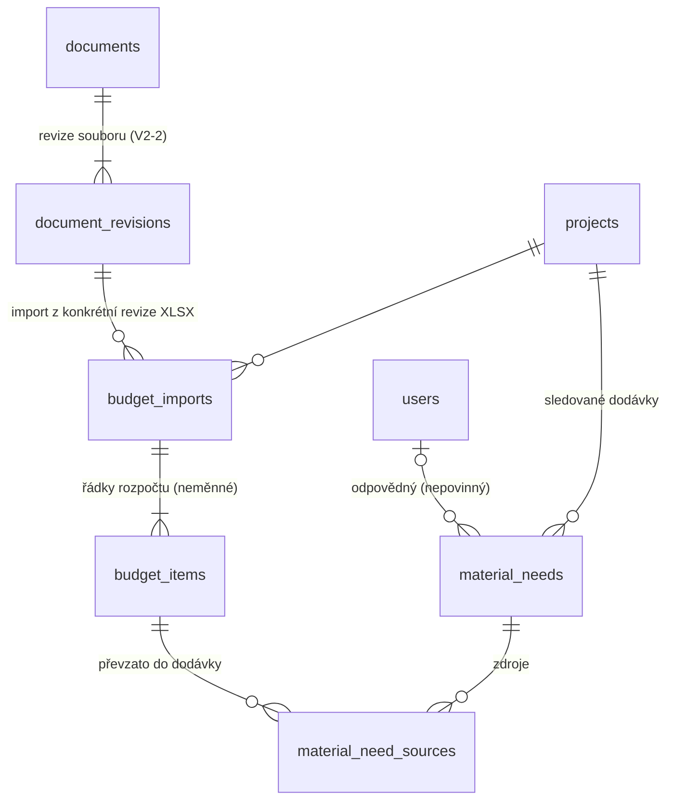

# Databáze V2-3 – návrh migrace 0003 (rozpočet a sledovaný materiál) ke schválení

> **Stav: SCHVÁLENO a APLIKOVÁNO (18. 11. 2026)** na vývojovou databázi V2 s fiktivními daty; implementace V2-3 hotová.
> Migrace `0003_v2_3_rozpocet_material` je v `drizzle/schvalene-migrace.json` a už se nemění.

## 1. Tabulky a vztahy

| Tabulka | Účel | Hlavní sloupce |
|---|---|---|
| `budget_imports` | potvrzený import rozpočtu | zakázka, **revize souboru**, nastavení sloupců pro každý list (JSON), měna (jen potvrzená), ceny s/bez DPH (jen potvrzené), stav `active` / `voided` + důvod, autoři, `version` |
| `budget_items` | řádky rozpočtu | import, **list + číslo řádku**, **původní buňky** (JSON: hodnota, příznak vzorce, chyba Excelu), **druh řádku navržený** a **platný** (materiál · práce · služba · nadpis · mezisoučet · ostatní), kód, popis, MJ původní + sjednocená, množství **původní text + číslo + stav** (číslo · chybí · není číslo · nejednoznačné), **jednotková a celková cena zvlášť** (původní text + číslo), důvody ruční kontroly, vyřízení kontroly (kdo/kdy/poznámka) |
| `material_needs` | sledovaná dodávka | zakázka, název, **důvod sledování** (5 schválených + vlastní text), **množství plánované k zajištění** + MJ, **odpovědný (nepovinný → „Nepřiřazeno“)**, poznámka, stav `to_confirm` / `archived` + důvod, `version` |
| `material_need_sources` | ze kterých položek dodávka vznikla | dodávka, položka, **množství převzaté z rozpočtu** (prázdné u nečíselného množství), **důvod překročení**, poznámka, kdo/kdy |

**Množství jsou oddělená (rozhodnutí 5):** množství **v rozpočtu** (položka, neměnné) · množství **převzaté** z položky do dodávky
(vazba) · množství **plánované k zajištění** (dodávka). Ruční dodávka nemá žádný zdroj.

Peníze a množství jako přesná čísla (`numeric`). **Žádný nový sloupec s termínem** – termíny přijdou ve V2-4
(pravidlo jednoho zdroje termínů ověřuje stávající strážní test).

## 2. Co hlídá přímo databáze

| Pravidlo | Jak |
|---|---|
| Import jen z **XLSX dokumentu druhu „Rozpočty“ téže zakázky** | trigger při vložení; zakázku ani zdrojovou revizi importu nelze později změnit |
| **Jedna revize = nejvýše jeden platný import** (žádný duplicitní import) | jedinečný index jen pro platné importy; zneplatnění jen s důvodem |
| Import s navázanými dodávkami **nelze zneplatnit** | trigger – existující dodávky a vazby se nikdy nepřepisují automaticky |
| **Původní hodnoty z Excelu neměnné** | trigger: měnit lze jen platný druh řádku a vyřízení ruční kontroly; položky nelze mazat |
| Řádek listu jen jednou v importu; položky jen do platného importu | jedinečnost (import, list, řádek); trigger |
| Množství se nevymýšlí | číslo jen se stavem „číslo“; jinak prázdné; „chybí“ nemá ani původní text |
| Měna a DPH se nevymýšlejí | prázdné = neznámé; měna jen třípísmenný kód (CZK…) |
| Jiný důvod sledování má vždy text | CHECK |
| Dodávku nelze přesunout do jiné zakázky; archivace jen s důvodem | trigger, CHECK |
| Položka a dodávka **téže zakázky**; import platný; dodávka nearchivovaná | trigger u vazby |
| **Nadpis ani mezisoučet nelze sledovat** (práce/služba ano – rozhodne člověk) | trigger u vazby |
| Číselná položka → převzaté množství povinné; nečíselná/nejednoznačná → prázdné | trigger u vazby |
| **Překročení množství z rozpočtu jen s důvodem**; původní množství se nemění | trigger sečte převzatá množství přes nearchivované dodávky; zámek položky proti souběhu |
| Obnovení archivované dodávky nepřekročí množství potichu | trigger při obnovení |
| Stejná položka v jedné dodávce jen jednou; vazbu nelze přepojit (jen odebrat a přidat – s historií) | jedinečnost, trigger |
| Nic nezmizí kaskádou | všechny cizí klíče `ON DELETE RESTRICT` |

**Sloučení** (3 položky → 1 dodávka) i **rozdělení** (1 položka → 2 dodávky) ověřené testy; zdroj je vždy dohledatelný
přes vazbu → položka (list, řádek, původní buňky) → import → revize souboru → dokument.

Pravidla, která **nehlídá databáze, ale budou ve službách** (V2-3 implementace): oprávnění (sledující jen čte),
upozornění na novější revizi rozpočtu, upozornění na shodný soubor (SHA-256) a na již sledovanou položku, historie.

## 3. Ochrana paměti a stability při čtení Excelu (změřeno 17. 11., implementováno 18. 11. 2026)

| Fiktivní rozpočet | Soubor | Rozbaleno | Špička paměti `read-excel-file` | Čas |
|---|---|---|---|---|
| 20 000 řádků × 30 sloupců | 4,4 MB | 30 MB | 217 MB | 1,1 s |
| 50 000 řádků × 40 sloupců | 16 MB | 102 MB | 525 MB | 3,8 s |

Paměť roste zhruba **5× nad rozbalenou velikost** – samotný limit 300 MB z V2-2 by u rozpočtu nestačil. Návrh pro implementaci:
1. **Před čtením** (vlastní kontrola kontejneru z V2-2): rozbalená velikost listů + sdílených textů rozpočtu **≤ 40 MB**,
   ≤ 50 listů; jinak srozumitelné odmítnutí („rozpočet je příliš rozsáhlý – rozdělte ho“).
2. **Čtení v SAMOSTATNÉM PROCESU** (bezpečnější než vlákno – vlákno sdílí paměť procesu a jeho strop nepokrývá vše,
   např. data mimo hlavní paměť JavaScriptu): strop paměti JavaScriptu 384 MB, **hlídání skutečné paměti procesu**
   (RSS 640 MB, Linux), časový limit 60 s, omezení výstupu 80 MB, proces nedostane žádné tajné proměnné.
   Pád nebo ukončení procesu aplikaci neovlivní – uživatel dostane srozumitelnou zprávu (ověřeno testy).
3. Limity **jednoho listu** (20 000 řádků, 200 sloupců) i **celého souboru** (50 listů, 50 000 řádků, 1 000 000 buněk,
   40 MB po rozbalení); najednou nejvýše **jedno čtení** rozpočtu (další čekají, nejvýše 3 ve frontě).
   Překročení = srozumitelná zpráva a **žádný neúplný import**.
4. Náhled pracuje s prvními řádky; plné čtení až při potvrzení importu.

## 4. Testy schématu (nové / upravené)

- **Přechod** z databáze V2-1 + V2-2 (včetně fiktivních dokumentů): migrace 0003 projde a otisk všech dosavadních dat je shodný.
- Import: jen XLSX / druh Rozpočty / tatáž zakázka; jeden platný na revizi; zneplatnění s důvodem; neměnnost zdroje; měna a DPH.
- Položky: neměnné původní hodnoty; povolená změna druhu a vyřízení kontroly; zákaz mazání; stavy množství; jedinečný řádek.
- Dodávky: ruční bez rozpočtu; nepovinný odpovědný; jiný důvod s textem; nepřesunutelné; archivace s důvodem.
- Vazby: sloučení 3→1; rozdělení 1→2 (6+4) bez změny původního množství; překročení jen s důvodem; archivované se nepočítají;
  obnovení hlídáno; nečíselné množství; nadpis a mezisoučet zakázány; tatáž zakázka; jedinečnost; zákaz přepojení;
  zákaz zneplatnění importu s dodávkami; nic se nemaže kaskádou; nové druhy záznamů historie.
- Strážní test: 11 tabulek, žádný nový sloupec s termínem; pojistka: 0003 čeká na schválení.

Výsledek: `npm run check` ✅ – **235 testů** (z toho 16 nových pro 0003); `npm run test:e2e` ✅ 18 (V2-1 a V2-2 beze změny,
na dočasné testovací databázi včetně 0003); `drizzle-kit check` ✅; vývojová databáze beze změny.

Pozn.: souběh dvou současných vazeb na tutéž položku hlídá zámek v databázi; PGlite (vývojová databáze) má jediné spojení,
takže souběh v testu nelze vyvolat – zámek je ověřen až na skutečném PostgreSQL (ostrý provoz).

## 5. Dopad migrace 0003

- Jen **přidává** 4 tabulky a rozšiřuje povolené hodnoty historie. Zakázky, události, oprávnění a dokumenty se nemění (ověřeno testem).
- Po schválení: zařadit do `schvalene-migrace.json` → vývojová databáze `npm run db:migrate` (aplikace vypnutá).
- Žádná nová knihovna v tomto kroku (`read-excel-file` se přidá až s implementací importu).

## 6. Omezení testování na PGlite (výslovně)

Vývojová i testovací databáze je **PGlite** (PostgreSQL v jednom procesu) s **jediným spojením**:
- souběžné operace se v ní **řadí za sebou**; testy souběhu (dvojí import, současné převzetí stejné položky,
  souběžná úprava dodávky) proto ověřují **správný výsledek** (nic se nezdvojí ani tiše nepřekročí), ne skutečné
  paralelní zamykání (`pg_advisory_xact_lock`, `SELECT … FOR UPDATE`, jedinečné indexy při současných transakcích);
- **před skutečným víceuživatelským provozem je nutné tyto testy zopakovat na plnohodnotném PostgreSQL**
  (zařadit do podmínek ostrého provozu spolu se zálohami, přihlášením a antivirem).
