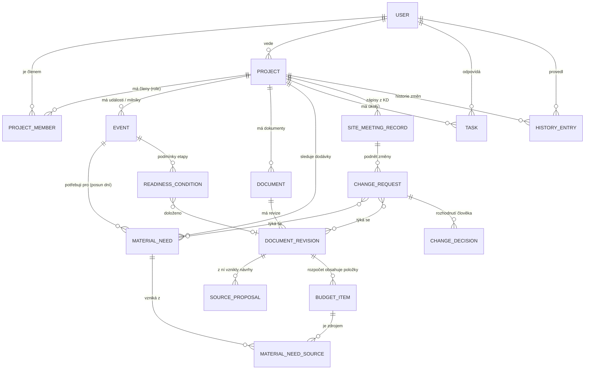

# Logický datový model – návrh k připomínkám

> **Toto NENÍ databázové schéma ani migrace.** Je to mapa pojmů a vztahů k odsouhlasení.
> Fyzické tabulky vzniknou až po rozhodnutí otázek v [OTAZKY-PRED-DATABAZI.md](OTAZKY-PRED-DATABAZI.md).
> Model V1 se nepřebírá automaticky (V1 byla postavená kolem analýzy smluv, V2 kolem zakázky, materiálu a připravenosti).

## 1. Základní principy

| Princip | Jak se promítá do modelu |
|---|---|
| Zakázka je centrum | Téměř každý záznam nese `zakázku`; oprávnění se vyhodnocují po zakázkách. |
| Jeden údaj = jeden zdroj | Datum montáže existuje jen v **Události**. Materiál, připravenost i přehled na ni jen odkazují. |
| Fakta ≠ plán ≠ výpočet | Skutečné datum, plánované datum a vypočtené doporučení jsou různá pole; výpočty se neukládají jako fakta. |
| Neověřeno ≠ nesplněno | Stavy podmínek mají výslovné `neověřeno`; chybějící údaj (např. dodací lhůta) = „ověřit“, ne odhad. |
| Návrh ≠ potvrzení | Výstup importu je **Zdrojový návrh**; potvrzená hodnota žije v cílovém záznamu a odkazuje na návrh jako původ. |
| Nic se nepřepisuje potichu | Revize dokumentu je nový záznam; opravy faktů mají důvod; vše jde do **Historie**. |

## 2. Mapa vztahů

## 3. Entity

### Zakázka (Project)
Název, typ (nová ČOV / rekonstrukce / intenzifikace / jiná), odpovědný vedoucí (uživatel), objednatel (text),
stav (příprava / realizace / … – předání až později), **potvrzená cena díla** (+ odkaz na návrh, ze kterého vznikla).
Nejbližší etapa se **neukládá** – odvozuje se z událostí.

### Uživatel, role a členství (User, ProjectMember)
- **Uživatel** – identita z poskytovatele přihlášení (viz otázka Q3), jméno, aktivní/neaktivní.
- **Globální role**: `správce` (spravuje role a členství) / `uživatel`.
- **Členství v zakázce** s rolí: `vedoucí` / `zástupce` (zápis) / `sledující` (jen čtení přidělených zakázek – R1, S16).
- Oprávnění = čistá doménová funkce `can(uživatel, akce, zakázka)`, vyhodnocovaná **na serveru**.
  Změna role je záznam v historii.

### Událost a milník (Event)
Jedna událost = jedna věc v čase (např. „Předání staveniště“, „Zahájení montáže technologie“).
- Oddělená data: **smluvní termín**, **interní plán**, **skutečné datum** (+ kdo a kdy zapsal).
- **Milník = příznak na události**, ne kopie.
- Oprava skutečného data vyžaduje důvod → historie.
- „Etapa“ pro připravenost i materiál = odkaz na událost (typicky její začátek). Jiná kopie data montáže neexistuje.

### Položka rozpočtu (BudgetItem)
Řádek z importovaného rozpočtu (revize dokumentu): kód, název, množství, jednotka, jednotková/celková cena,
druh (práce / materiál / soubor), číslo listu a řádku (dohledatelnost). **Neměnná zdrojová data** –
oprava rozpočtu = nová revize. Příznak „sledovaná cenová komponenta“ pokrývá R8 (ceny vybraných komponent).

### Materiálová potřeba / sledovaná dodávka (MaterialNeed + MaterialNeedSource)
- Název, množství, jednotka, odpovědný (jeden).
- **Potřebuji pro**: odkaz na událost + posun dní (−7, 0, +10), **nebo** výjimečně ruční datum + povinný důvod.
- **Dodací lhůta**: číslo + typ dnů (pracovní / kalendářní); prázdná = „Ověřit dodací lhůtu“.
- **Rezerva**: výchozí 14 kalendářních dnů (R4), měnitelná.
- **Fakta o objednávce**: potvrzení ke sledování, skutečné datum objednání, dodavatel / číslo objednávky,
  potvrzený termín dodání, skutečné dodání. Posun události je **nikdy nepřepisuje**.
- **Termín objednání a stav** (k potvrzení → objednat → objednáno → potvrzené dodání → dodáno) se **počítají** v doméně.
- **MaterialNeedSource** = vazba M:N na položky rozpočtu (s volitelným podílem množství) → sloučení i rozdělení
  (S13). Ruční dodávka nemá žádný zdroj. Duplicita = stejná položka rozpočtu už je zdrojem jiné dodávky → vyžaduje potvrzení.

### Podmínka připravenosti (ReadinessCondition)
Odkaz na událost (etapu), název, odpovědný, termín ověření, stav `neověřeno / splněno / nesplněno / schválená výjimka`,
volitelný důkaz (revize dokumentu nebo poznámka). Výjimka vyžaduje osobu, důvod a datum.
**Souhrnná připravenost etapy se neukládá** – odvozuje se z podmínek (žádné ruční pole „montáž připravena“).
Šablony podmínek (R5) zatím ne.

### Úkol (Task)
Text, termín, odpovědný, stav, zakázka (předvyplněná z kontextu). Volitelně: druh (mikroúkol / smluvní),
zdroj (např. revize smlouvy + článek), doklad splnění, druhá kontrola. Předání jinému člověku → historie.
Úkol **neblokuje** etapu – blokaci určuje jen podmínka připravenosti.

### Dokument a revize (Document, DocumentRevision)
- **Dokument** = logická věc (např. „Výkres D.1.3 Technologie“), skupina (smlouvy / rozpočty / výkresy / KD /
  stavební deník / protokoly a revize / fotografie / ostatní), odkaz na **aktuální revizi** (jediný ukazatel).
- **Revize** = konkrétní soubor: označení revize, datum, kdo nahrál, název souboru, velikost, typ, **otisk SHA-256**,
  klíč v úložišti. Soubor se nikdy nepřepisuje ani tiše nemaže. Starší revize zůstávají dohledatelné (S9).

### Zdrojový návrh (SourceProposal)
Neověřený údaj vyčtený z dokumentu (smlouva / rozpočet): cíl (např. „cena díla zakázky“), navržená hodnota,
přesné umístění ve zdroji, rozhodnutí člověka (přijato / upraveno / zamítnuto), kdo a kdy.
Potvrzená hodnota je **jen v cílovém záznamu**; návrh slouží jako původ.

### Záznam z KD, podnět změny a rozhodnutí (SiteMeetingRecord, ChangeRequest, ChangeDecision)
- **Záznam z KD**: datum, krátký text, volitelně revize dokumentu se zápisem.
- **Podnět změny**: popis, možný dopad (cena / termín / materiál / technické řešení / nevím), další krok,
  odpovědný, vazby na dodávky a dokumenty, stav prověřování.
- **Rozhodnutí** je samostatná lidská událost (kdo, kdy, výsledek, zdrojový dokument). Bez něj nevzniká
  schválená vícepráce ani změna ceny (S8).

### Historie změn (HistoryEntry)
Pouze přidávaná (append-only): kdo, kdy, zakázka, typ a id záznamu, akce, hodnoty před/po, **důvod**.
Zapisuje se ve stejné transakci jako změna. Slouží k auditu, ne jako zdroj aktuálního stavu.

## 4. Co se počítá (domain), nikoli ukládá

| Odvozený údaj | Ze kterých faktů |
|---|---|
| Datum potřeby materiálu | plán události + posun, nebo ruční výjimka |
| Nejzazší termín objednání | datum potřeby − rezerva − dodací lhůta (pracovní/kalendářní dny, svátky); bez lhůty = „ověřit“ |
| Stav dodávky | potvrzení, fakta objednávky a dodání, dnešní datum |
| Připravenost etapy | stavy podmínek |
| „Co dnes řešit“ | všechno výše + úkoly + podněty + nepotvrzené návrhy; **seskupeno podle příčiny** (jedna příčina = jedna karta) |

## 5. Záměrně mimo model V2-1
Fakturace, sklad, výkazy práce, ziskovost, sankce, šablony připravenosti, výroba/expedice u dodavatele,
předání díla, notifikace mimo aplikaci, integrace SharePointu.
