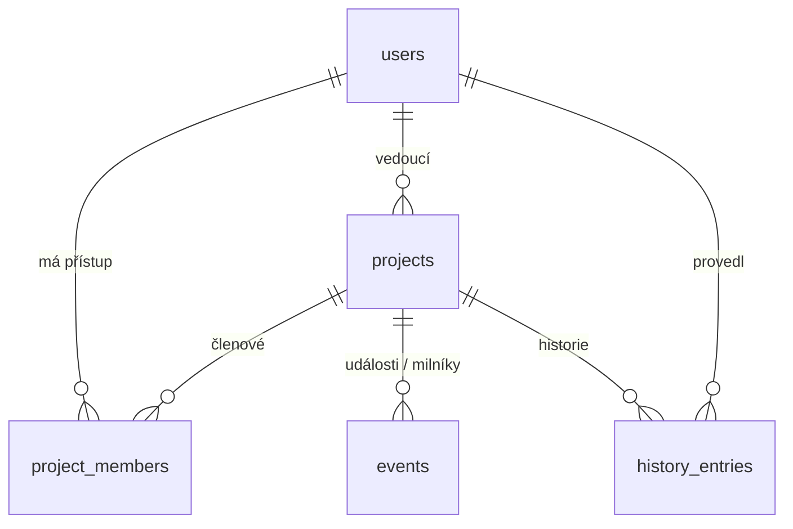

# Plán etapy V2-1 – zakázka, uživatelé, oprávnění, události a milníky

> **Stav: SCHVÁLENO s upřesněním (17. 11. 2026).** Upřesnění jsou zapracovaná níže a ve schématu;
> podrobný návrh první migrace je v [DATABAZE-V2-1.md](DATABAZE-V2-1.md).
> Vychází z Master zadání v1.0 a rozhodnutí Q1–Q12 ([OTAZKY-PRED-DATABAZI.md](OTAZKY-PRED-DATABAZI.md)).

## 1. Cíl etapy

Na fiktivních datech půjde:
- založit a upravit zakázku (název, typ, vedoucí, objednatel), archivovat ji s důvodem;
- přidělit lidi k zakázce (jen správce) a ověřit, že každý vidí a smí jen to, co má (scénář S16);
- evidovat události a milníky zakázky se **smluvním / plánovaným / skutečným** datem, každé jen jednou;
- u každé změny vidět historii (kdo, kdy, co, před/po, důvod);
- při souběžné úpravě dvou lidí nic tiše nepřepsat;
- přepínat mezi fiktivními vývojovými identitami – pouze ve vývojovém režimu.

Mimo etapu: materiál, rozpočty, připravenost, úkoly, dokumenty, KD, obsah „Co dnes řešit“ (viz kap. 7).

## 2. Databázové tabulky (V2-1)

Pět tabulek. Typy: `uuid` (generuje server), `date` = den bez času (`RRRR-MM-DD`), `timestamptz` = okamžik v UTC
(zobrazení Europe/Prague). Každá upravitelná tabulka má `version`, `created_at/by`, `updated_at/by`.

### `users` – uživatelé
| Sloupec | Typ | Poznámka |
|---|---|---|
| `id` | uuid PK | |
| `email` | text, unikátní (malými písmeny) | u vývojových identit fiktivní `…@example.test` |
| `display_name` | text | |
| `global_role` | `admin` \| `deputy` \| `viewer` | správce / zástupce / sledující; výchozí sledující (upřesněno při návrhu schématu) |
| `is_dev_identity` | boolean | `true` = fiktivní vývojová identita; v produkci se s ní **nelze** přihlásit |
| `status` | `active` \| `deactivated` | uživatel se nemaže, jen deaktivuje |
| `version`, časové a autorské údaje | | |

Tabulky pro hesla a relace přihlášení **nevznikají** – přinese je až ověřené autentizační řešení (kap. 7).

### `projects` – zakázky
| Sloupec | Typ | Poznámka |
|---|---|---|
| `id` | uuid PK | |
| `name` | text, povinné | |
| `project_type` | `new_plant` \| `reconstruction` \| `intensification` \| `other` | nová ČOV / rekonstrukce / intenzifikace / jiná |
| `project_type_note` | text | povinné jen u `other` |
| `leader_user_id` | FK → users | odpovědný vedoucí; musí mít k zakázce přístup pro úpravy |
| `client_name` | text, nepovinné | objednatel (zatím jen text) |
| `status` | `preparation` \| `realization` \| `archived` | |
| `archived_at/by`, `archive_reason` | | archivace vždy s důvodem (Q9) |
| `version`, časové a autorské údaje | | |

**Zakázka nemá žádný sloupec s termínem** (zahájení, montáž, předání…) – všechny termíny jsou jen v `events`.
Cena díla se do V2-1 nepřidává (patří k financím a zdrojovým návrhům – později).

### `project_members` – kdo má přístup k zakázce
| Sloupec | Typ | Poznámka |
|---|---|---|
| `project_id` + `user_id` | složený PK, FK | |
| `access` | `edit` \| `read` | `edit` = zástupce/vedoucí, `read` = sledující |
| `added_at/by` | | |

Odebrání člena = smazání řádku + záznam v historii (historie je dohledatelný zdroj).
Správce (`global_role = admin`) vidí vše i bez členství.

### `events` – události a milníky
| Sloupec | Typ | Poznámka |
|---|---|---|
| `id` | uuid PK | |
| `project_id` | FK → projects | |
| `kind` | výčet (níže) | |
| `title` | text | u typových událostí předvyplněno, u `other` povinné |
| `is_milestone` | boolean | **milník = příznak na události, ne kopie** |
| `contract_date` | date, nepovinné | smluvní termín |
| `planned_date` | date, nepovinné | interní plán |
| `actual_date` | date, nepovinné | skutečně nastalo |
| `actual_recorded_at/by` | | kdy a kdo skutečné datum zapsal |
| `note` | text, nepovinné | |
| `status` | `active` \| `cancelled` | zrušení s důvodem (`cancel_reason`, `cancelled_at/by`) |
| `version`, časové a autorské údaje | | |

Navržené typy (`kind`): `site_handover` Předání staveniště · `construction_start` Zahájení stavebních prací ·
`assembly_start` Zahájení montáže technologie · `trial_operation` Zkušební provoz / komplexní zkoušky ·
`completion_handover` Předání díla · `other` Jiná událost.

### `history_entries` – historie změn (jen přidávání)
| Sloupec | Typ | Poznámka |
|---|---|---|
| `id` | uuid PK | |
| `at` | timestamptz | |
| `actor_user_id` | FK → users | |
| `project_id` | FK, nepovinné | podle něj se řídí, kdo historii smí číst (Q7) |
| `entity_type`, `entity_id` | | např. `event` + id |
| `action` | `create` \| `update` \| `archive` \| `cancel` \| `member_add` \| `member_remove` \| `member_change` | |
| `changes` | jsonb | `{ pole: { before, after } }` |
| `reason` | text, nepovinné | povinné tam, kde to vyžaduje pravidlo (kap. 3) |

Databázový trigger odmítne `UPDATE` a `DELETE` nad touto tabulkou (ověří se testem).

### Vztahy

## 3. Jak se zabrání duplicitnímu ukládání termínů

1. **Jediné místo pro termíny zakázky je tabulka `events`.** `projects` ani žádná budoucí tabulka nesmí mít
   vlastní kopii data události. Budoucí moduly (materiál, připravenost) budou mít jen odkaz `event_id` + posun dní.
2. **Strážní test schématu:** automatický test projde všechny tabulky a sloupce typu `date`; povolené jsou jen ty
   na seznamu (s odůvodněním). Nový datový sloupec mimo seznam = test selže → vědomé rozhodnutí místo omylu.
3. **Každá událost je samostatná:** vlastní id, vlastní název a vlastní smluvní / plánované / skutečné datum
   (všechna nepovinná). **Více událostí stejného typu v jedné zakázce je povoleno** (např. montáž linky 1 a 2) –
   rozhodnutí vlastníka. Budoucí materiál a připravenost odkazují na konkrétní `events.id`, nikdy na typ.
4. **Milník není kopie:** jen příznak `is_milestone` na téže události.
5. **Tři druhy data v jedné události, nikdy se nezaměňují.** Doménová funkce vrací datum **i jeho původ**:
   „skutečně 3. 3. 2027“ / „plán 3. 3. 2027 (zatím nenastalo)“ / „smluvně do …“ / „**čeká na ověření**“ (žádné datum).
   Plánované datum se nikdy neukazuje jako nastalé.
6. **Odvozené údaje se neukládají** (nejbližší událost, počet dní do termínu, „po smluvním termínu“).
7. **Opravy s důvodem:** změna smluvního data a oprava již zapsaného skutečného data vyžadují důvod;
   změna plánu důvod nevyžaduje, ale jde do historie. Skutečné datum nesmí být v budoucnosti.

## 4. Vývojová identita (bez skutečného přihlášení)

**Princip: v produkčním režimu je technicky vypnutá a aplikace „selže zavřeně“** (bez přihlášení nic neukáže).

- Rozhraní `IdentityProvider` v serverové vrstvě: `currentUser()` vrací přihlášeného uživatele nebo nic.
  Později se za něj připojí ověřené autentizační řešení, aniž se změní zbytek aplikace.
- `DevIdentityProvider` funguje jen při **současném** splnění:
  1. vývojový server (`next dev`, `NODE_ENV=development`) – produkční build má vždy `production`;
  2. proměnná `DEV_IDENTITIES=enabled` (nastavená v Codespaces a v `.env.development`, nikdy v produkci);
  3. vybraný uživatel má `is_dev_identity = true` a je aktivní.
- Volba identity = soubor cookie (httpOnly, SameSite=Lax) s id uživatele. Žádná hesla, žádné tokeny.
  Server **při každém požadavku** znovu ověří podmínky 1–3; podvržená cookie s ne-vývojovým uživatelem nic nezíská.
- V produkčním režimu: přepínací akce vrátí chybu, cookie se ignoruje, stránka ukáže
  „Přihlášení zatím není k dispozici“. Ověří se automatickým testem i kontrolou po `npm run build`.
- Viditelné označení: **červený pruh** přes celou šířku „VÝVOJOVÁ IDENTITA – NENÍ ZABEZPEČENO – jen fiktivní data“
  se jménem a rolí, tlačítko „Přepnout“.
- Fiktivní lidé (podle R1): Správce, Zástupce, Sledující 1, Sledující 2 – jména zjevně smyšlená, e-maily
  `@example.test`. Vytváří je jen příkaz `npm run db:seed` spolu s 2–3 fiktivními zakázkami.

## 5. Oprávnění

Čistá doménová funkce `can(uživatel, akce, zakázka)`; volá ji **každá** serverová služba před čtením i zápisem.

| Akce | Správce | Člen s `edit` (zástupce) | Člen s `read` (sledující) | Bez členství |
|---|---|---|---|---|
| Vidět zakázku, události, historii | ✅ | ✅ | ✅ | ❌ (jako by neexistovala) |
| Založit zakázku | ✅ | ✅ (stane se členem s `edit`) | ❌ | ❌ |
| Upravit zakázku, události, zapsat skutečné datum | ✅ | ✅ | ❌ | ❌ |
| Archivovat zakázku (s důvodem) | ✅ | ❌ | ❌ | ❌ |
| Přidávat / odebírat členy, měnit role | ✅ | ❌ (Q11) | ❌ | ❌ |
| Fyzické smazání | jen správce, v V2-1 se neprogramuje | ❌ | ❌ | ❌ |

Sledující v obrazovkách tlačítka pro úpravy nevidí, ale **rozhoduje kontrola na serveru**, ne skryté tlačítko.

## 6. Souběžné úpravy (Q8) a historie (Q7)

- Formulář nese číslo verze záznamu. Uložení proběhne jen tehdy, když se verze v databázi nezměnila
  (`UPDATE … WHERE id = ? AND version = ?`). Jinak: „Záznam mezitím upravil(a) *jméno* v *čas*. Vaše změny
  nebyly uloženy – načtěte aktuální stav.“ Nic se tiše nepřepíše.
- Každá změna = **jedna transakce**: změna + záznam historie. Když selže jedno, neuloží se nic.
- Uživatel uvidí „Uloženo“ až po potvrzení serverem (S11).

## 7. Obrazovky V2-1

| Adresa | Obsah |
|---|---|
| `/zakazky` | seznam **dostupných** zakázek (název, typ, vedoucí, stav, nejbližší událost s původem data); tlačítko „Nová zakázka“ jen s oprávněním |
| `/zakazky/nova` | krátký formulář: název, typ, vedoucí, objednatel |
| `/zakazky/[id]` | detail se záložkami **Přehled · Materiál · Úkoly · Připravenost · Dokumenty**. Funkční je jen Přehled: základní údaje, „Termíny a milníky“, členové, poslední změna. Ostatní záložky = jasně označený prázdný stav |
| `/zakazky/[id]/upravit` | úprava základních údajů, archivace s důvodem |
| `/zakazky/[id]/udalosti/nova`, `/zakazky/[id]/udalosti/[eventId]` | přidání a úprava události; zápis skutečného data; zrušení s důvodem |
| `/zakazky/[id]/clenove` | členové a jejich přístup (úpravy jen správce) |
| `/zakazky/[id]/historie` | historie změn zakázky (druhá úroveň, čtou i sledující) |
| `/vyvoj/identita` | výběr fiktivní identity – existuje jen ve vývojovém režimu |

„Co dnes řešit“ a „Moje úkoly“ zůstávají prázdným stavem (jejich obsah závisí na dalších modulech).
Vše použitelné na mobilu bez vodorovného posouvání; hlavní tlačítka ≥ 44 px.

## 8. Testy V2-1

| Druh | Co ověří |
|---|---|
| Doména (Vitest) | matice oprávnění (všechny role × akce); původ data události (skutečné / plán / smluvní / čeká na ověření); validace (typ `other` vyžaduje popis, skutečné datum ne v budoucnu, důvod u opravy); kalendář Europe/Prague a české svátky (převzato z V1 i s testy) |
| Služby + databáze (Vitest + PGlite v paměti) | změna a historie ve stejné transakci, při chybě se neuloží nic; konflikt verzí; sledující nemůže zapisovat **na serveru**; nečlen zakázku „nevidí“; druhá typová událost je odmítnuta; historie nejde upravit ani smazat |
| Schéma | strážní test datových sloupců; migrace se aplikují na prázdnou databázi |
| Vývojová identita | v režimu `production` nefunguje přepnutí ani cookie; bez `DEV_IDENTITIES` nefunguje ani ve vývoji; nelze se přepnout na ne-vývojového uživatele |
| End-to-end (Playwright) | správce založí zakázku a událost; sledující ji vidí, ale nemůže upravit (S16); souběžná úprava ve dvou oknech skončí hlášením konfliktu; mobilní šířka bez posouvání |

## 9. Nové závislosti ke schválení

| Balíček | K čemu | Cena |
|---|---|---|
| `drizzle-orm` 0.45, `drizzle-kit` 0.31 | přístup k databázi, verzované migrace (Q2) | zdarma, open-source |
| `@electric-sql/pglite` 0.5 | PostgreSQL pro vývoj bez instalace (Q1) | zdarma, open-source |
| `@playwright/test` | end-to-end testy v prohlížeči | zdarma, open-source |

Data vývojové databáze: složka `data/` (v `.gitignore`, nikdy do Gitu).

## 10. Postup a zastavení

1. Závislosti, databázový adaptér, převzetí kalendáře z V1, Drizzle schéma v TypeScriptu.
2. **STOP – předložím vygenerovanou první migraci (SQL) ke schválení.** Bez souhlasu se nepoužije.
3. Doménová pravidla a služby s testy.
4. Vývojová identita + seed fiktivních dat.
5. Obrazovky, end-to-end testy, `npm run check`, odeslání větve, pull request.

## 11. Co zůstává na později

Skutečné přihlášení e-mailem a heslem (výběr ověřené knihovny, např. Better Auth nebo Auth.js – samostatné
rozhodnutí), správa uživatelů v aplikaci, cena díla a finance, materiál, rozpočty, připravenost, úkoly,
dokumenty a úložiště souborů, KD a změny, obsah „Co dnes řešit“, fyzické mazání správcem, export ZIP/CSV,
zálohy a obnova, ostrý hosting.

## 12. Rozhodnutí vlastníka (17. 11. 2026)

1. Zástupce **smí zakládat** zakázky a automaticky k nim získá přístup `edit`.
2. Archivovat smí **jen správce**.
3. Typy událostí jsou **výchozí nabídka**; vlastní název je možný a **více událostí stejného typu** v zakázce je povoleno.
4. Vedoucí je **automaticky členem s `edit`** (vynucuje databáze).
5. Závislosti schváleny po kontrole kompatibility, licencí a bezpečnosti (viz [DATABAZE-V2-1.md](DATABAZE-V2-1.md), kap. 6).
